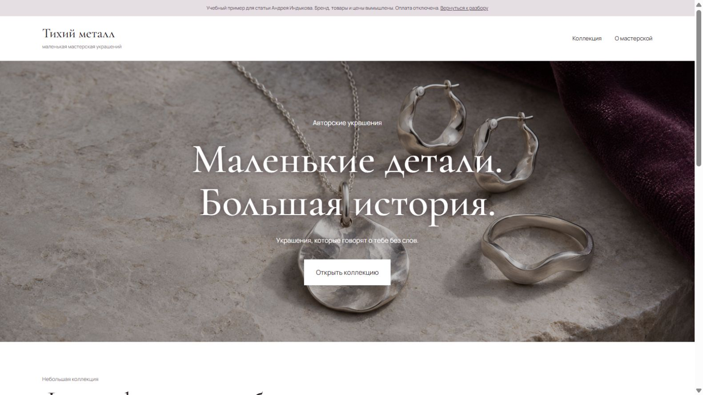
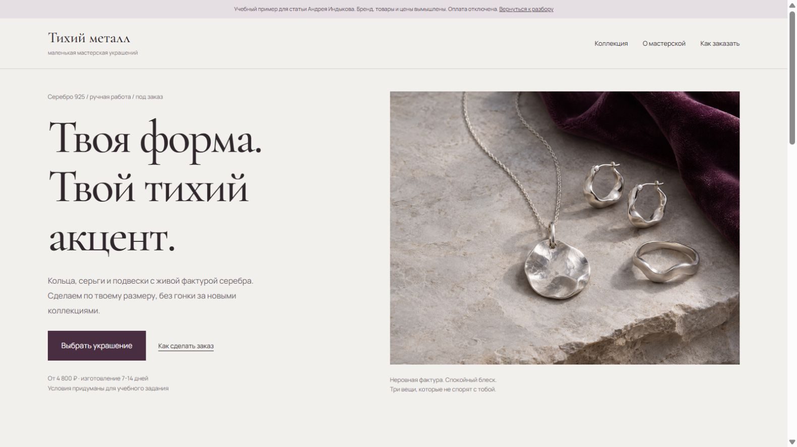
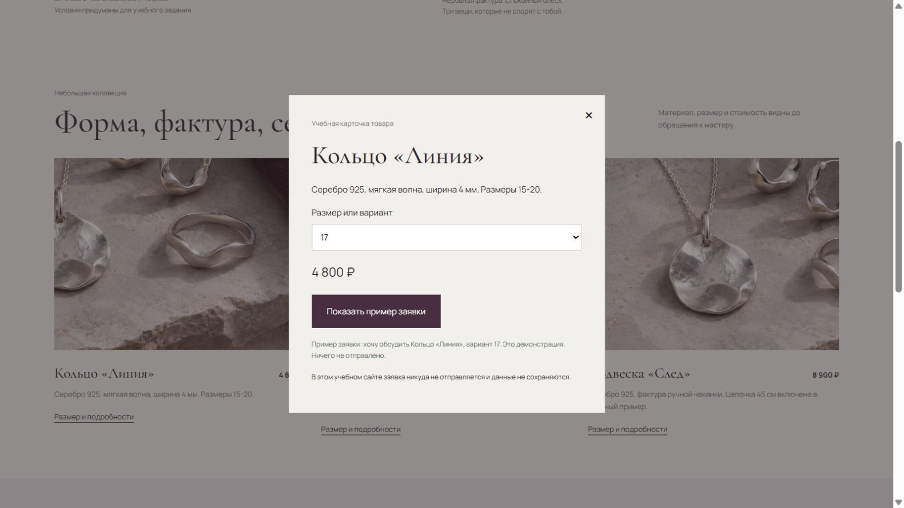

Просишь ИИ написать нормальное письмо. Получаешь восемь абзацев про плодотворное сотрудничество. Вроде по-русски, даже вежливо. Отправить хочется только в папку «потом разберусь».

Вместо следующей сложной роли в запросе я предлагаю собрать карточку задачи. Она полезна и для модели, и для человека: помогает понять, какой результат вообще нужен.

## Где заканчивается задача и начинается угадывание

«Напиши хороший текст» не сообщает, кто его прочитает, что уже известно и какое действие ожидается. Модель достраивает недостающее. Иногда угадывает удачно. Иногда получается торжественное письмо, в котором нет нужного вопроса.

Представь более конкретную ситуацию: надо предупредить заказчика о задержке одного этапа и согласовать новый срок. Для черновика существенны факты о готовности, причина переноса, реалистичный срок и доступные варианты. Если этих данных нет в запросе, красивый стиль не заменит их.

Перед передачей материала учитывай правила своего сервиса и работы. Для тренировки можно использовать обезличенный пример. Не нужно загружать клиентскую переписку, чтобы научиться формулировать цель письма.

## Собери четыре части задания

**Результат и адресат.** Что должно получиться и кто будет этим пользоваться? В примере нужен короткий черновик письма заказчику, с которым уже идёт работа.

**Исходный материал.** Какие факты надо сохранить? Например: этап готов частично, новая дата такая-то, следующий этап пока не затронут. Не проси модель выдумывать недостающую готовность или обещать срок вместо тебя.

**Ограничения и форма.** Какой объём нужен, какая интонация уместна, что обязательно назвать и чего добавлять нельзя? Достаточно конкретных условий, связанных с задачей.

**Проверка.** По каким признакам поймёшь, что черновик пригоден? Указан новый срок, ясна просьба о согласовании, факты сохранены, нет новых обещаний. Уже по этому списку можно отличить полезный результат от просто длинного.

## Черновик запроса на бытовом примере

Можно написать так: «Подготовь короткое письмо постоянному заказчику. Нужно сообщить о переносе этапа с пятницы на вторник и спросить, подходит ли новый срок. Сохрани только перечисленные факты. Не придумывай причины задержки. Тон спокойный, деловой, без торжественных вступлений. Если информации не хватает, укажи вопрос отдельно».

Это не универсальная формула для любых писем. Её ценность в том, что видно назначение, материал и границы. Для другой ситуации карточка изменится.

После ответа сверь каждое обязательство и дату. Посмотри, понятен ли вопрос адресату. Удали пустые любезности, если они мешают. Решение отправить письмо принимаешь ты; модель подготовила только вариант.

## А теперь сайт: «сделай красиво» в полный рост

С письмом различие заметить проще: дата потерялась, просьба исчезла, вместо трёх предложений приехал торжественный доклад. У сайта больше способов выглядеть убедительно, пока задача остаётся туманной. Большая фотография, приятный шрифт, три карточки. Смотришь и думаешь: ну сайт же. Красивый.

Возьмём точный исходный промпт:

> сделай красивый сайт для продажи авторских украшений

Что из него известно? Нужен сайт, на нём будут украшения, предполагаются продажи. Что означает «красивый», кто покупатель, что именно продаём, как человек заказывает, какие условия должны быть видны до обращения? Здесь модели оставлено большое поле для догадок.

Для разбора подготовлены два учебных сайта бренда «Тихий металл». Бренд, товары, характеристики, цены и сроки вымышлены. Изображение украшений создано ИИ. Это демонстрация разницы между общей и конкретной постановкой задачи. Она не является независимым экспериментом моделей и не показывает, какой сайт продаёт лучше: реальных покупок и замеров конверсии здесь нет.

### Первая версия: атмосфера есть, вопросы остаются

[Открыть первую версию сайта](/examples/jewelry/before/).

Первый экран встречает словами «Маленькие детали. Большая история.» и обещает украшения, которые говорят о тебе без слов. Кнопка ведёт к коллекции. Ниже три изделия с названиями и ценами: кольцо «Линия» за 4 800 ₽, серьги «Течение» за 6 200 ₽ и подвеска «След» за 8 900 ₽. Под каждым одинаковое описание: «Ручная работа. Вдохновение в каждой детали».

Это вполне понятная витрина. Только вдохновение не отвечает на вопросы о металле, размере и сроке изготовления. На первом экране этих сведений нет. В открывающихся карточках характеристики уже доступны, но до нажатия покупатель видит главным образом настроение и цену. Отдельного объяснения порядка заказа тоже нет.

При этом первая версия не сделана намеренно сломанной. У неё работают переход к коллекции, открытие карточек, выбор варианта и показ примера заявки. Обе версии используют один и тот же механизм карточки. Различие стоит искать в том, какую информацию человек получает и в какой момент, а не приписывать второй версии функции, которые уже были в первой.

### Что уточнить до следующего запроса

Слова «добавь премиальности» дадут модели ещё одно расплывчатое пожелание. Можно получить больше воздуха и более загадочный заголовок. Покупатель всё ещё не знает, когда ему сделают кольцо.

Здесь полезнее определить несколько вещей. Для кого эта коллекция? Какие сведения нужны для выбора? Что произойдёт после нажатия кнопки? Как отличить учебные условия от реальных обещаний? Ниже конкретный бриф для нашего примера. Он описывает направление второй версии; это не журнал дословного запуска и не гарантия получить такой же экран одним запросом.

> Сделай учебный одностраничный сайт вымышленной мастерской авторских украшений «Тихий металл».
>
> Задача страницы: помочь человеку, который выбирает лаконичное украшение для себя, посмотреть коллекцию, узнать основные условия и подготовить обращение к мастеру. Главное действие: выбрать изделие и открыть пример заявки. Настоящую отправку и оплату не подключать.
>
> Учебная коллекция из серебра 925: кольцо «Линия», 4 800 ₽, ширина 4 мм, размеры 15-20; серьги «Течение», 6 200 ₽ за пару, высота 22 мм; подвеска «След», 8 900 ₽, цепочка 45 см включена. Изготовление под заказ, условный срок 7-14 дней. Все эти сведения вымышлены для демонстрации. Не выдавай их за условия действующей мастерской.
>
> На первом экране покажи материал, характер коллекции, начальную цену и срок. Дай понятные переходы «Выбрать украшение» и «Как сделать заказ». В коллекции рядом с каждым изделием покажи его цену и конкретное описание. По нажатию на изображение или ссылку открывай карточку с названием, характеристиками, ценой и выбором размера или варианта.
>
> В карточке кнопка «Показать пример заявки» должна выводить текст с выбранным изделием и вариантом. Явно сообщи, что ничего не отправлено и данные не сохраняются. Добавь порядок заказа из трёх шагов: выбрать вещь, обсудить детали, подтвердить условия до оплаты. Вопросы и ответы должны объяснять размер кольца, учебный срок и невозможность купить в демо.
>
> Оформление: спокойная светлая витрина, выразительная типографика, серебро и фактура как главный визуальный материал. Сохрани читаемость на телефоне. Используй предоставленную AI-иллюстрацию и обозначь её происхождение. Не придумывай отзывы, историю реального мастера, награды или показатели продаж.
>
> Проверь переходы, открытие и закрытие карточки, выбор варианта и текст заявки. На узком экране проверь чтение, кнопки и отсутствие горизонтальной прокрутки. Фотография не подтверждает состав металла: в настоящем проекте характеристики и условия должен предоставить владелец.

### Вторая версия: появляется маршрут к решению

[Открыть сайт после уточнения задания](/examples/jewelry/after/).

Теперь на первом экране есть конкретная опора: серебро 925, ручная работа, изготовление под заказ, цена от 4 800 ₽ и срок 7-14 дней. Там же обозначено, что условия учебные. Можно сразу перейти к выбору украшения или посмотреть, как устроен заказ.

В коллекции вместо трёх одинаковых фраз появились характеристики каждого изделия. У кольца видны ширина и диапазон размеров, у серёг высота и цена за пару, у подвески упоминание цепочки. Ниже объяснены три шага заказа и разобраны вопросы о размере, сроке и возможности покупки. Сайт сообщает, что настоящая отправка и оплата не подключены.

Открой карточку, выбери вариант и нажми «Показать пример заявки». На странице появится текст с названием изделия и выбранным вариантом, а также сообщение, что ничего не отправлено. Это позволяет проверить логику обращения без настоящего заказа. Покупателя здесь не просят вводить телефон или платёжные данные.

Есть и [снимок второй версии на телефоне](/assets/examples/jewelry/after-mobile.jpg). В мобильной компоновке блоки идут друг под другом, коллекция становится одной колонкой. Скриншот показывает расположение, но нажатия, закрытие карточки и чтение длинного текста нужно проверять на самой странице.

### Почему результат отличается

В уточнённом задании появились решения, которые в коротком запросе предлагалось угадать. Названа ближайшая цель посетителя, даны сведения о товарах, определён способ обращения, описаны необходимые состояния интерфейса. Поэтому обсуждать результат можно предметно: есть ли цена до открытия карточки, понятен ли срок, попадает ли выбранный вариант в заявку.

Длина промпта сама по себе ничего не гарантирует. Можно написать три страницы про изысканность и не указать способ заказа. Полезную часть брифа составляют факты, решения и проверки. Если владелец сам пока не знает сроки, лучше оставить вопрос открытым, чем получить от модели выдуманные «7-14 дней» и случайно пообещать их покупателю.

В нашем примере визуальное оформление тоже изменилось. Поэтому приписывать все различия только уточнению текста запроса было бы некорректно. Мы показываем два подготовленных интерфейса и объясняем связь между требованиями и их реализацией. Для вывода о продажах понадобились бы работающий магазин, сопоставимые посетители и отдельная проверка.

### По каким признакам проверять такой сайт

1. **Понятность предложения.** Без поиска по всей странице видно, что продаётся, из какого материала, по какой цене и с каким сроком? Для реального магазина все эти сведения подтверждены владельцем?
2. **Путь к обращению.** Из коллекции можно открыть нужное изделие, выбрать вариант и получить заявку именно с ним? Можно закрыть карточку и продолжить выбор?
3. **Честность действий.** Демонстрация сообщает, что заявка не отправлена. У настоящего магазина должны быть отдельно проверены отправка, подтверждение и обработка ошибок. Красивой кнопки для этого мало.
4. **Работа на телефоне.** Текст читается без увеличения, кнопки доступны, карточка помещается на экране, поля не уезжают за край? Проверять стоит не только первый экран.
5. **Соответствие изображения товару.** Здесь одна сгенерированная иллюстрация используется и целиком, и в кадрированных фрагментах. Для продажи нужны реальные фотографии каждого изделия, по которым можно оценить форму, масштаб и детали. AI-картинка этого не подтверждает.

У демо остаются ограничения. Например, список вариантов в карточке общий для трёх изделий: он показывает сам принцип выбора, но не заменяет отдельную настройку размеров кольца и вариантов серёг или подвески. Доставка, уход, возвраты, наличие и реальная обработка заявок тоже требуют исходных данных и отдельной реализации. Уточнённый бриф делает задачу проверяемой, но не превращает учебную страницу в готовый магазин автоматически.

## Исправляй по критерию

«Сделай лучше» снова заставляет угадывать. Полезнее сказать: «В первом абзаце потерялся факт о частичной готовности. Верни его и убери обещание дополнительной работы». Так ты меняешь конкретную часть результата.

Если ни один вариант не подходит, проверь исходную постановку. Возможно, задача на самом деле требует сначала принять решение или получить факты. ИИ может помочь сформулировать вопросы, но не добывает автоматически сведения из твоего проекта.

Ниже можно собрать карточку своей задачи. Для обучения важно ещё и сохранять самостоятельность: попробуй объяснить, почему ответ подходит и что в нём исправил. Об этом есть [разбор самопроверки знаний](/articles/chitayu-no-ne-pomnyu/).
