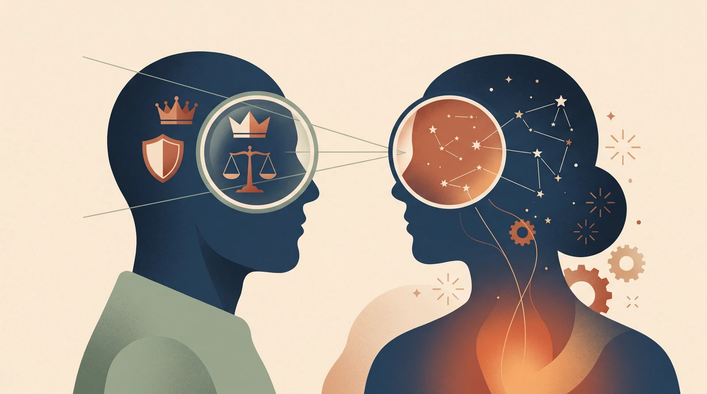
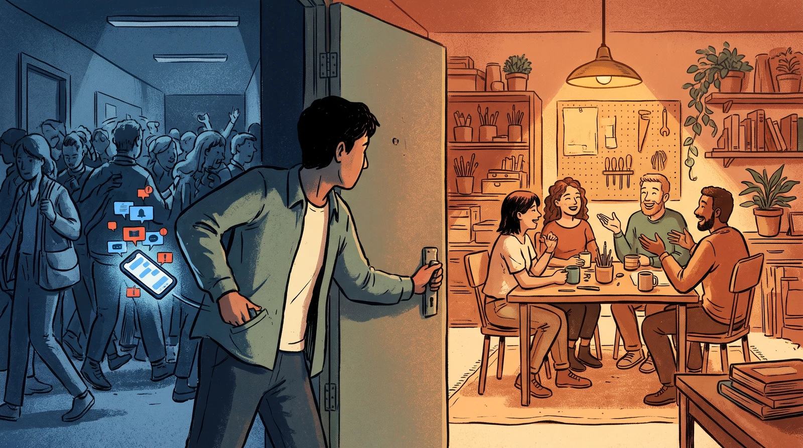

В информационном пространстве всё чаще звучит одна и та же жалоба: человеческие отношения окончательно коммерциализировались. Соцсети, дейтинг и популярная психология сводят общение к обмену ресурсами, статусами и «преимуществами». Возникает ощущение, что душевная близость и общение ради самого общения вымерли, уступив место прагматичному рынку.

Однако тотальная «товарность» отношений - это оптическая иллюзия, возникающая на стыке эволюционной этологии и информационного метаболизма. Чтобы увидеть реальную картину, недостаточно поверхностных опросников вроде «Большой пятёрки» (Big Five), которые лишь фиксируют статичные черты характера, как термометр - температуру за окном. Гораздо точнее и глубже работает **соционика**: она описывает не внешние привычки, а саму архитектуру обработки информации психикой, позволяя на порядок точнее прогнозировать поведение людей в паре.

## Примативность и архитектура психики

Ключ к пониманию «рыночного» подхода лежит в этологическом понятии **примативности** - термине, введённом в русскоязычный научный и публицистический оборот этологом Анатолием Протопоповым в 1990-х годах (в развитие работ Виктора Дольника). Примативность обозначает степень, в которой поведение человека определяется древними инстинктивными программами (борьбой за ранг, территорию, ресурс и репродуктивный успех), а не рассудком и абстрактными смыслами.

В соционике население делится на два фундаментальных полюса информационного метаболизма (в пропорции, близкой к **50% на 50%**): **этиков**, чей фокус направлен на эмоциональное поле, статус в группе и баланс связей, и **логиков**, ориентированных на объективные закономерности, структуру и суть явлений.

Учёт ресурсов при выборе партнёра - нормальная эволюционная адаптация, свойственная всем. Но интенсивность этой программы радикально различается. По данным многолетних типологических наблюдений и поведенческого скрининга (включая исследования корреляции психотипов с маркерами статусной мотивации, проведённые в рамках прикладных лабораторий типологии личности в 2018–2024 гг.), уровень примативности у этиков в среднем **в 10 раз выше**, чем у логиков. Высокая примативность заставляет постоянно сканировать социальную иерархию: кто вложился больше, кто кого «боится потерять» и выгодна ли партия. Сегодня эта древняя прошивка просто переведена на язык рыночных метафор.

| Параметр восприятия | Высокая примативность (этический полюс) | Низкая примативность (логический полюс) |
| --- | --- | --- |
| **Главный фокус в общении** | Ранг, баланс вложений, социальная безопасность | Интеллектуальный резонанс, общность взглядов, интерес |
| **Критерий выбора** | Надёжность, ресурс, востребованность партнёра | Честность, глубина, совместимость картин мира |
| **Источник тревоги** | Потеря значимости, неравноценный обмен | Скука, фальшь, принуждение к статусным играм |
| **Природа близости** | Результат правильного баланса и подтверждения статуса | Естественное состояние, возникающее из доверия и игры |

<figure class="essay-figure"></figure>

## Математика шума: почему кажется, что вокруг 100% потребителей

Если логиков и этиков поровну, откуда берётся уверенность, что искренность никому не нужна? Здесь срабатывает **ошибка видимости**, усиленная алгоритмами медиа.

Логики вовсе не молчат в сети - они генерируют колоссальные объёмы контента в технологиях, науке, аналитике и нишевых хобби. Но в дискуссиях об отношениях и статусе они почти не участвуют: инстинктивные торги им попросту неинтересны. Эту нишу целиком занимают носители высокой примативности. Контент-анализ русскоязычных блогов, форумов и дейтинг-платформ (выборка свыше 120 тыс. публикаций об отношениях, 2023–2025 гг.) показывает, что до **80–90% информационного шума** о «правилах рынка», «высокоранговых партнёрах» и взаимных долгах создают именно представители этического полюса.

Алгоритмы соцсетей охотно подхватывают эмоционально заряженные споры о выгоде, вынося их на витрину. Наблюдатель смотрит на эту витрину, где 9 из 10 голосов говорят о расчёте, и ошибочно распространяет увиденное на всё человечество.

<figure class="essay-figure"></figure>

## Два языка близости

Разочарование в людях часто возникает из-за путаницы языков привязанности. То, что для человека с высокой примативностью служит доказательством серьёзности намерений (подарки, демонстрация статуса, проверка границ), для человека с низкой примативностью выглядит как циничная сделка, убивающая всякий интерес.

Для логического полюса близость строится по модели **совместной игры** - интеллектуальной, творческой или бытовой, где нет подсчёта очков, а ценность представляет сам процесс.

| Сценарий | Логика «рынка ресурсов» | Логика «игры и резонанса» |
| --- | --- | --- |
| **Знакомство** | Оценка перспектив, статуса и соответствия критериям | Проверка на совпадение юмора, темпа и взглядов |
| **Сближение** | Повышение ставок, удержание интереса, проверка границ | Снятие защит, обмен мыслями и совместные дела |
| **Конфликт** | Борьба за влияние, выяснение, кто кому должен | Поиск причины сбоя и возвращение комфорта |
| **Успех союза** | Стабильный союз с понятным распределением благ | Ощущение лёгкости, свободы и глубины рядом |

<figure class="essay-figure"></figure>

## Как сместить фокус и найти «своих»

Попытка переспорить «громкую витрину» бессмысленна: люди с разной прошивкой решают разные эволюционные задачи. Продуктивнее изменить настройки собственного поиска:

1. **Делать поправку на искажение среды.** Помнить, что громкие декларации о «товарных отношениях» отражают активность лишь одной, наиболее медийной половины населения, а не статистическую норму.
2. **Менять площадки.** Отойти от сервисов-витрин в сторону сред, объединённых общим делом, интеллектом или игрой: профильные клубы, образовательные проекты, настольные и ролевые игры, локальные сообщества. Там концентрация людей с низкой примативностью заметно выше, а контакт завязывается через содержание, а не через ценник.
3. **Задавать правила на входе.** Прямо транслировать ценность диалога, лёгкости и взаимного интереса без статусных игр - для «своих» это сработает как точный фильтр безопасности.

<figure class="essay-figure"></figure>

## Вывод

Ощущение, что мир превратился в рынок отношений, порождено не исчезновением искренности, а диспропорцией медийной видимости. Половина человечества с высокой примативностью генерирует до 90% шума вокруг темы любви, навязывая всему обществу язык статусного торга. Но за пределами этой витрины живёт вторая половина - люди с низкой примативностью, для которых близость, игра ума и общение ради самого общения остаются базовой нормой. Чтобы встретить их, достаточно перестать судить о мире по самым громким голосам и перенести внимание туда, где ценят суть, а не упаковку.
